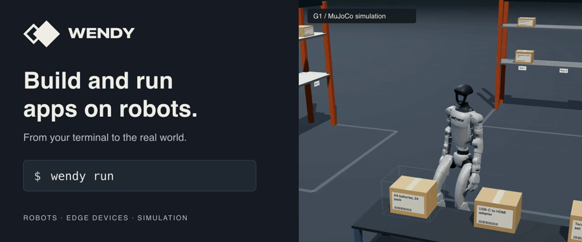

<a href="https://wendy.dev/videos/wendy-g1-warehouse-turbopuffer-2026-09-29.mp4">
  <picture>
    <source media="(prefers-reduced-motion: reduce)" srcset=".github/assets/readme/header.png">
    
  </picture>
</a>

# Wendy

Build, deploy, and debug apps on robots, Raspberry Pis, Jetsons, and Linux devices.
Bring your Dockerfile or Compose project. Start with hardware or a simulator.

[Get started](https://docs.wendy.dev/latest/getting-started/app/) · [Watch the demo](https://wendy.dev/videos/wendy-g1-warehouse-turbopuffer-2026-09-29.mp4) · [Examples](Examples) · [Discord](https://discord.gg/wendylabsinc)

## Install

On macOS or Linux:

```sh
curl -fsSL https://install.wendy.dev/cli.sh | bash
wendy --version
```


On Windows:

```powershell
winget install WendyLabs.Wendy --source winget
```

The Linux app examples below use a macOS or Linux terminal. On Windows, use
WSL2 with the Wendy CLI and Docker with Buildx installed inside WSL2.

[Other installation methods and updates](INSTALL.md)

## Choose a starting point

### Use your own device

```sh
wendy tour --hardware
```

The tour guides you through device setup. Start with a Raspberry Pi, NVIDIA
Jetson, or an existing Linux computer or robot.
[Find the setup guide for your hardware](https://docs.wendy.dev/latest/installation/).

### Try a simulated robot

```sh
wendy tour --simulator
```

The tour creates a simulated Unitree Go2, opens its 3D viewer, and runs a short
walking demo. No physical robot or cloud account is needed. The installer may
start the tour automatically.

You need macOS or Linux, Docker with Buildx, and QEMU. Allow 4 GiB of memory for
the VM and several minutes for the first download and build. Apple Silicon is
the fastest path; x86 Linux uses ARM64 emulation.
See [simulator setup](https://docs.wendy.dev/latest/installation/wendyos-virtual-machine/)
for prerequisites. When finished, use the `wendy vm stop` command printed by the tour.

## Build and deploy an app

With your device set up and Docker running, create a small HTTP app:

```sh
wendy init hello-wendy --target wendyos --language node --template simple-api --var APP_ID=hello-wendy --assistant skip --git-init no
cd hello-wendy
wendy run
```

Select your device. Open the address Wendy prints and check for
`{"message":"hello-world"}`. Press Ctrl+C, edit `src/index.ts`, save, then run
`wendy run` again against the same target. Node.js runs inside the container.
Follow the [full walkthrough](https://docs.wendy.dev/latest/getting-started/app/)
for watch mode, local-only Linux targets, and stopping the app when finished.

## Why Wendy?

The CLI runs on your computer; Wendy Agent runs on your device,
manages your apps, and returns logs. Install the Agent on an existing Linux system,
or use WendyOS with the Agent included.

- **Build and deploy:** use Docker or Compose, build for the target, and send changes with `wendy run`.
- **Work with hardware:** declare camera, GPU, and device access in `wendy.json`; inspect ROS 2 nodes and topics.
- **Use a coding agent:** connect through MCP to deploy changes and inspect the device.

Local development needs no cloud account. [Wendy Cloud](https://cloud.wendy.dev)
adds remote access and fleet management. [Compare deployment options](https://docs.wendy.dev/latest/concepts/why-wendy/).

## Build with a coding agent

After your first successful run, you can let a coding agent deploy changes and
inspect the device through Wendy's MCP server:

```sh
wendy mcp setup
```

Follow the [coding-agent setup guide](https://docs.wendy.dev/latest/guides/llm-integration/)
for supported tools. For ChatGPT, see the [ChatGPT guide](https://docs.wendy.dev/latest/guides/chatgpt/).


## Keep building

- [Robot apps](https://docs.wendy.dev/latest/integrations/ros2/) with ROS 2 in containers, remote topic inspection, and a Foxglove bridge.
- [Camera and AI apps](https://docs.wendy.dev/latest/hardware/) with access to cameras, audio, and GPUs.
- [Multi-service apps](https://docs.wendy.dev/latest/guides/multi-app-deployments/) with ROS 2 talkers, listeners, and shared configuration.
- [Data collection](https://docs.wendy.dev/latest/data/) that records sensor data, app events, and model results around triggers.

Browse the [examples](Examples) or follow a
[tutorial](https://docs.wendy.dev/latest/guides/tutorials/) to build your next app.
[Wendy Cloud](https://cloud.wendy.dev) adds remote access and fleet management.
Local development does not require a cloud account.
